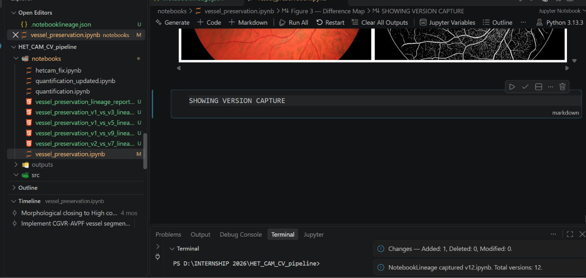
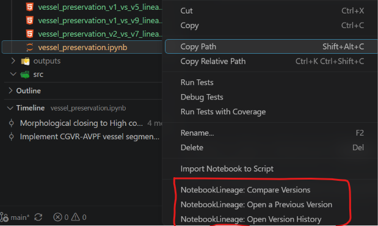

# NotebookLineage

### Every notebook tells a story. Keep track of yours.

**NotebookLineage** is a notebook version-tracking and change-analysis tool built for anyone who works with Jupyter Notebooks.

It keeps track of how your notebooks evolve, saves successive versions, shows you exactly what changed, gives change comparison of 2 notebooks and gives you a visual history of your work — all integrated into **Visual Studio Code**.

---

## So, where did this idea come from?

**It all started with one accidentally deleted cell.**

I was working on a retinal vessel segmentation workflow during my internship. The notebook had several interconnected stages of image processing, and I was constantly experimenting, modifying code, and refining the workflow.

At one point, I accidentally deleted an important cell. That one deletion disrupted the cells that followed. Trying to recover the earlier implementation and figuring out what had changed turned into a frustrating process.

It made me realise something: we spend so much time developing computational workflows, but keeping track of how those workflows evolve is often left to us.

We save copies, rename files, scroll through old notebooks, or try to remember what we changed.

And then I started wondering: What if there was a tool that automatically saved different versions of a notebook, kept track of every change, and maintained a complete history of how the notebook evolved? Something that would let me go back, see what I had changed, and pick up where I left off without spending hours trying to recover lost work. And surely, I wasn't the only one who could use something like that.

**That was the beginning of NotebookLineage.**

What started as an attempt to solve a problem I encountered during biological image analysis gradually became a tool designed for anyone working with Jupyter Notebooks.

---

## What exactly does it do?

Think of NotebookLineage as a history of your notebook's development.

Every time your notebook changes and a new version is captured, NotebookLineage preserves that state. You can then explore its history, compare versions, and understand how your work has evolved.

### Here's what it currently offers:

### 1. Automatic version tracking

No more manually creating copies of your notebooks every time you make changes.

NotebookLineage captures successive notebook versions and stores them separately, preserving earlier implementations. It also checks whether the notebook has actually changed before creating another snapshot, avoiding unnecessary duplicate versions.

### 2. Cell-level change detection

Notebooks aren't just ordinary text files. They contain code cells, Markdown cells, and their own structure.

NotebookLineage compares notebook versions at the cell level and identifies:

- Added cells
- Deleted cells
- Modified cells
- Unchanged cells

For modified cells, it also provides line-level differences, helping you see what actually changed.

### 3. A visual notebook history

Ever wanted to know how your notebook progressed over time?

NotebookLineage generates an HTML history report with a visual timeline of saved versions, including a clear indicator of the latest snapshot.

### 4. Consecutive-version change summaries

Instead of looking only at the latest comparison, you can see how your notebook changed from one version to the next.

Each transition includes a summary of added, deleted, modified, and unchanged cells.

### 5. Compare selected versions

Want to revisit an earlier implementation or understand what changed between two particular versions?

NotebookLineage generates detailed comparison reports so you can inspect the differences between selected snapshots.

### 6. Visual Studio Code integration

NotebookLineage isn't just a standalone Python script.

It has a Visual Studio Code extension that connects the underlying Python engine to the notebook development environment. You can access notebook history and version comparisons directly through the editor.

---

## See it in action

The best way to understand NotebookLineage is to see what happens when a notebook actually changes.

**It starts with a notebook.**

**Save your work. NotebookLineage gets activated.**

### Access NotebookLineage directly through VS Code.

**Every captured change becomes part of your notebook history.**

**See how your notebook evolved.**

**Need to inspect a particular change? Compare versions.**

## Built using

NotebookLineage brings together a Python based backend and a Visual Studio Code extension.

| Component | Technologies |
|:---|:---|
| Core engine | Python |
| Notebook handling | `nbformat` |
| Content hashing | `hashlib` (SHA-256) |
| File and snapshot management | `pathlib`, `shutil` |
| Report generation | HTML, CSS |
| Editor integration | TypeScript, Node.js |
| Development environment | Visual Studio Code |

---

## A little more about the project

NotebookLineage was initially developed around a biological image-analysis workflow, specifically retinal vessel segmentation.

That workflow involved image processing using OpenCV, NumPy, Matplotlib, and scikit-image. It also became the practical demonstration environment for testing notebook version tracking and change detection.

But the idea was never to build something exclusively for biological research.

Whether you're working on machine learning experiments, data analysis, scientific computing, visualisation, or just your everyday Python projects, your notebooks represent hours of work and experimentation. NotebookLineage helps protect the work you've put into those notebooks by keeping a record of previous versions, making it easier to recover earlier work, understand changes, and stay in control of how your computational workflows develop.

---

## What's next?

This is an evolving project, and there's much more I want to build.

Here's what I want to work on next:

- **Restore previous versions:** Allow users to bring back an earlier version of their notebook when needed.
- **Track notebook executions:** Keep a better record of when notebooks are run and how their execution history relates to saved versions.
- **Track experiments:** Make it easier to keep track of changes made during repeated experiments and analyses.
- **Improve the VS Code extension:** Make version tracking and notebook history easier to access and use directly within VS Code.

The goal is to make notebook history and computational workflow tracking a natural part of working with Jupyter Notebooks.

---

## About this repository

This repository is a public showcase of NotebookLineage.

You'll find project documentation, screenshots, feature demonstrations, and details about its development and intended use.

The implementation source code is not included in this repository. The core implementation is currently maintained privately while the project continues to evolve.

---

### One deleted cell started it all. Let's see where it goes.

**NotebookLineage — Track your notebooks. Understand your changes. Keep your work connected.**

---

## Copyright

**NotebookLineage**

Copyright © 2026 NotebookLineage.

All rights reserved.

This repository contains public-facing documentation, demonstrations, and product information.

The NotebookLineage software implementation is proprietary and is not licensed for reproduction, redistribution, or commercial use.
